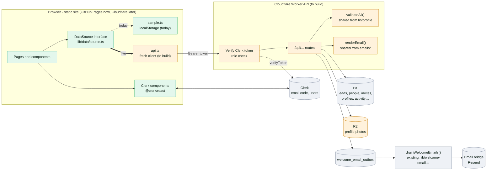
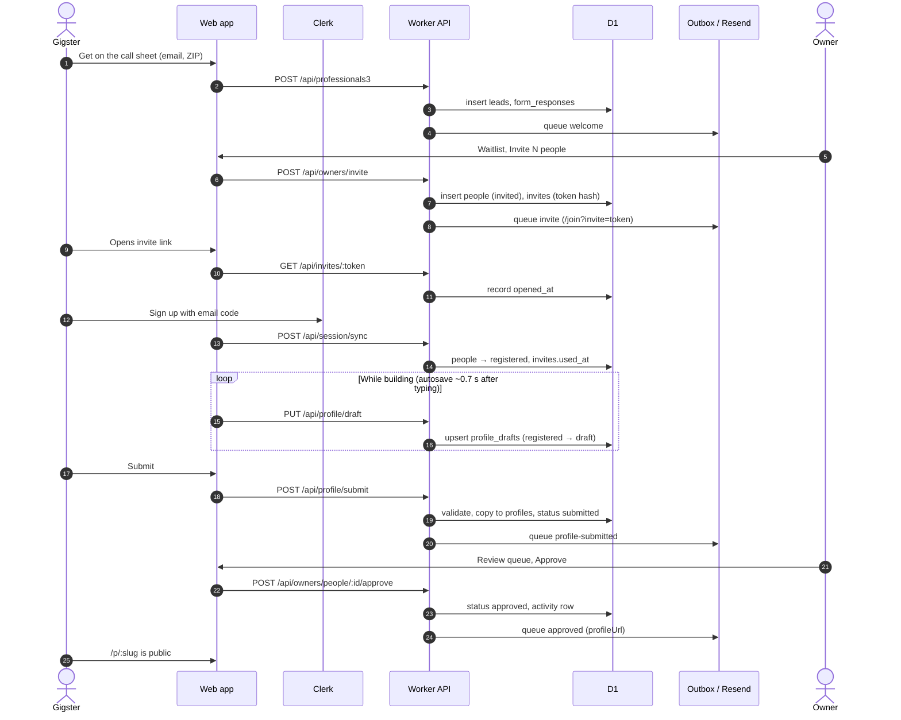
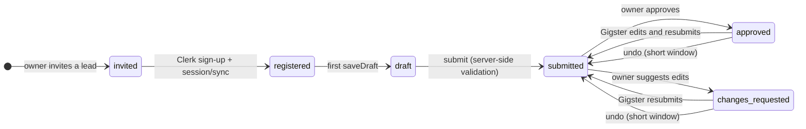
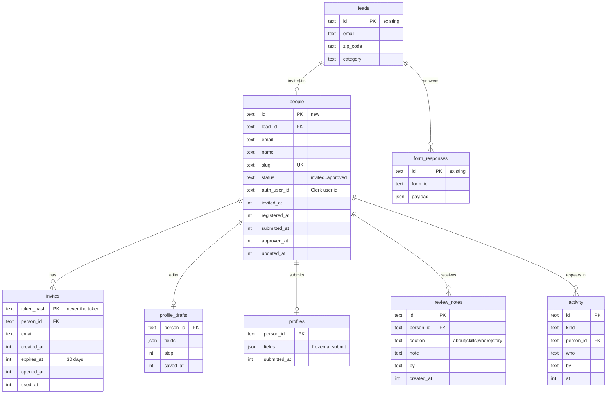
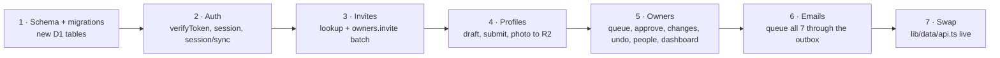

# Backend handoff (for Anu)

> **Superseded (2026-10-31).** The backend is Company OS, not the Cloudflare Worker this page plans: 2.0's own server
> routes (`lib/server/*`, `app/api/**`) call it, and the web server has no `CLERK_SECRET_KEY` (Company OS verifies the
> Clerk session token). What is live: [companyos-local.md](companyos-local.md), [companyos-deploy.md](companyos-deploy.md)
> and Company OS `docs/customers/between-gigs/gap-analysis.md` §13. Kept as the record of the first plan.

The front end is built and runs as a static site on sample data. Every read and write goes through one interface,
`DataSource` ([`lib/data/source.ts`](../../lib/data/source.ts)), so the backend work is a Worker API plus one
replacement implementation: write `lib/data/api.ts` with `fetch` calls and export it from `lib/data/index.ts`
(leave out the optional `demo` block). Method-by-method details: [data-layer.md](data-layer.md), owners:
[milestone-4.md](milestone-4.md), funnel: [milestone-3.md](milestone-3.md), sign-in: [clerk.md](clerk.md).

## Links

- Preview guide (sign in as any role): https://between-gigs.github.io/between-gig-2.0/preview/
- Live preview: https://between-gigs.github.io/between-gig-2.0/
- Owner dashboard: https://between-gigs.github.io/between-gig-2.0/owners/
- Every email + sample outbox: https://between-gigs.github.io/between-gig-2.0/emails/
- Reference behaviour: [`lib/data/sample.ts`](../../lib/data/sample.ts) · types: [`lib/data/types.ts`](../../lib/data/types.ts)
- Shared with the Worker: [`lib/profile/validate.ts`](../../lib/profile/validate.ts), [`emails/`](../../emails) (`renderEmail()`)
- Current live app (D1 schema, funnel routes, outbox drain): https://github.com/imagine-os/between-gigs (`db/schema.ts`, `lib/welcome-email.ts`)

## Architecture

## A Gigster's journey

## Profile status (`people.status`)

Only these transitions are allowed; reject anything else with 409. The public page reads `profiles`, and only while
the status is `approved`.

## Data model

Existing: `leads`, `form_responses`, `sketches`, `privacy_requests`, `welcome_email_outbox`. New (proposal):
`people`, `invites`, `profile_drafts`, `profiles`, `review_notes`, `activity`. `fields` is `ProfileFields` as JSON.

## Endpoints

One route per `DataSource` method; the full table with access rules is in [data-layer.md](data-layer.md) and
[milestone-4.md](milestone-4.md). Every owner route checks Clerk `publicMetadata.role === "owner"` server-side.
Never trust an email, role or person id from a request body. Not needed live: `auth.register`, `requestCode`,
`verifyCode` (Clerk does these), `emails.outbox / get` and `demo`. New beyond the interface: `POST /api/profile/photo`
(upload to R2; today the builder stores a 480px data URL).

## Emails

Queue a row in `welcome_email_outbox` (`message_type` = template, `template_payload` = JSON props). The live app's
drain (`drainWelcomeEmails`, `lib/welcome-email.ts`, via the email bridge) sends it; extend it to render every
template with `renderEmail(template, props, { assetBase: SITE_URL, siteUrl: SITE_URL })`.

| Template | Queued by | Props |
| --- | --- | --- |
| `welcome` | `funnel.joinWaitlist` | `storyboardUrl` |
| `coming-soon` | `funnel.submitSketch` | `kind` |
| `invite` | `owners.invite` | `inviteUrl` (`${SITE_URL}/join?invite=TOKEN`), `email` |
| `profile-submitted` | `profiles.submit` | `firstName`, `profileUrl`, `editUrl` |
| `approved` | `owners.approve` | `firstName`, `profileUrl`, `editUrl` |
| `changes-requested` | `owners.requestChanges` | `firstName`, `notes` (`section\|note` per line), `editUrl` |
| `sign-in-code` | not used with Clerk | `code`, `email`, `minutes` |

## Config

| Name | Where |
| --- | --- |
| `CLERK_SECRET_KEY` | Worker secret only, never the front end |
| `BG_EMAIL_BRIDGE_TOKEN` | Worker secret the live outbox drain already uses |
| `SITE_URL` | Worker var |
| `NEXT_PUBLIC_CLERK_PUBLISHABLE_KEY` | Front-end build (public by design) |
| `NEXT_PUBLIC_API_URL` | Front-end build: the Worker's base URL (new) |

## Build order

## Done when

- The live preview runs invite → join → build → submit → approve → `/p/slug` against the Worker, with real emails.
- Owner routes return 403 for a Gigster and 401 without a token; transitions outside the status diagram return 409.
- `pnpm check` still passes on the sample store (it's the UI's regression suite).
- No secret in the built `out/`.

## Open questions

1. Keep the front end on Pages with a separate Worker, or one Cloudflare project (then `@clerk/nextjs` middleware)?
2. New `profile_drafts` / `profiles` tables, or rows in `form_responses`?
3. Should an approved page stay live while a resubmission waits for review?
4. Invite all ≈500 at once, or in waves by ZIP or interest?
5. Reminders for unopened invites after N days?
6. Photo storage: R2 bucket, size limits, resize on upload or on read?
